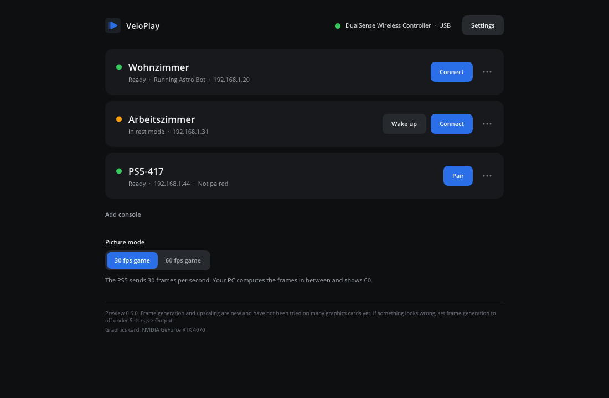
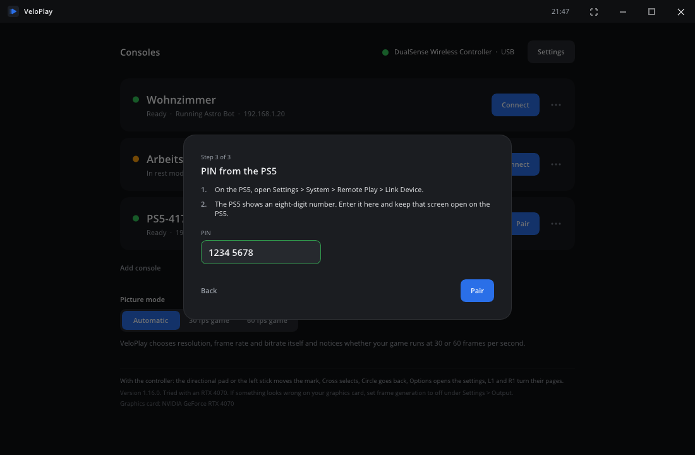
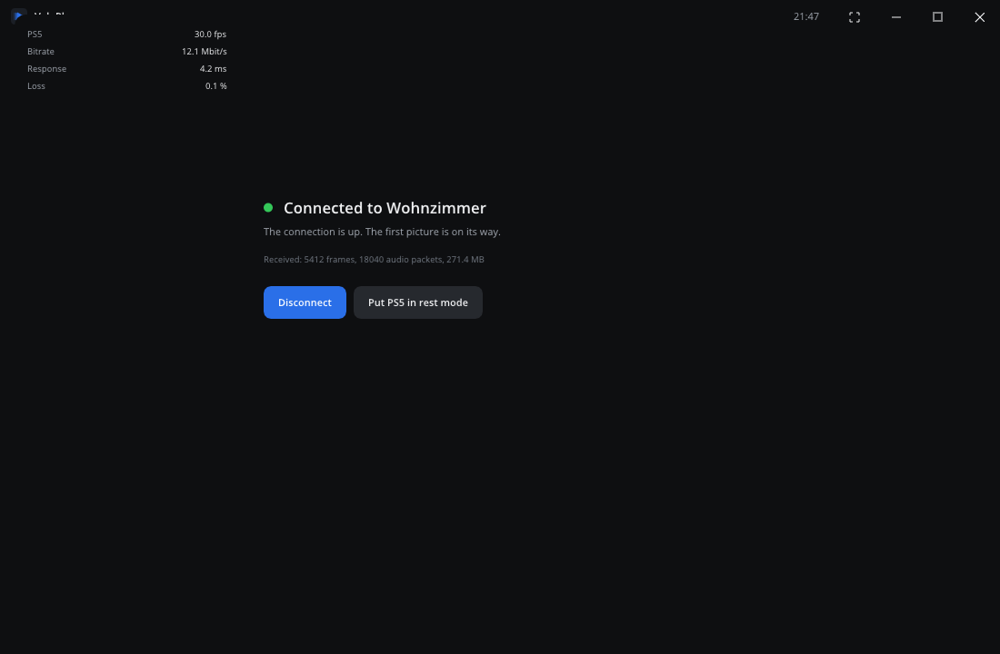

# VeloPlay

Ein Remote-Play-Client für die PS5 unter Windows. Er entsteht für eine Aufgabe: Konsolenspiele,
die mit 30 fps laufen, mit 60 fps auf dem Monitor sehen, sauber hochskaliert auf dessen Auflösung.

[English version](README.md)

> **Stand: 1.0.** VeloPlay findet deine PS5, koppelt sich mit ihr, weckt sie auf, verbindet sich
> und zeigt Bild und Ton am PC. Dein Controller steuert die Konsole, mit Vibration, adaptiven
> Triggern und Haptik, oder du spielst mit Maus und Tastatur. Läuft ein Spiel mit 30 fps, merkt
> VeloPlay das, berechnet die Bilder dazwischen und zeigt 60.
>
> All das ist an einer echten PS5 bestätigt, mit einer RTX 4070 und einem DualSense am Kabel.
> Noch nicht ausprobiert: das Mikrofon in einer Party, die Anmeldung bei PlayStation für die
> Account-ID, andere Grafikkarten und Controller. HDR ist noch nicht gebaut. Rückmeldungen sind
> willkommen.

VeloPlay ist ein unabhängiges Open-Source-Projekt. Es stammt nicht von Sony und wird von Sony
nicht unterstützt. „PlayStation“ und „PS5“ sind Marken von Sony Interactive Entertainment.





Gerendert mit `tools/ui_preview` in der englischen Fassung. Unter Windows nutzt der Client Segoe UI, die Buchstabenformen weichen deshalb leicht ab.

## Was heute geht

- Findet Konsolen im Netzwerk und zeigt, ob sie laufen, im Ruhemodus sind oder nicht erreichbar
- Koppelt eine Konsole in drei geführten Schritten und holt deine Account-ID auf Wunsch über die
  Anmeldung bei PlayStation
- Weckt eine gekoppelte Konsole aus dem Ruhemodus
- Verbindet sich mit der Konsole und zeigt das Bild im Fenster oder im Vollbild, mit Ton
- Wählt Auflösung, Bildrate und Datenrate selbst und lernt pro Konsole, was die Verbindung trägt
- Entpackt das Bild auf der Grafikkarte, wenn sie das kann, sonst auf dem Prozessor
- Erkennt ein Spiel, das mit 30 fps läuft, und berechnet die Bilder dazwischen, auf NVIDIA-Karten
  mit deren eigener Bewegungssuche
- Skaliert das Bild auf das Fenster hoch und schärft es, auf NVIDIA-Karten auf Wunsch mit RTX Video,
  und glättet die Farbstufen, die eine niedrige Datenrate in Himmeln hinterlässt
- Gibt die Eingaben deines Controllers an die Konsole weiter und bringt Vibration, adaptive
  Trigger und Haptik des DualSense zurück
- Lässt dich mit Maus und Tastatur spielen, mit Vorlagen und eigener Belegung pro Spiel
- Lässt sich selbst mit dem Controller bedienen und hat eine Seite, um den Controller zu testen
- Sendet dein Mikrofon für den Sprachchat an die Konsole
- Zeigt auf Wunsch Bildrate, Datenrate, Antwortzeit und Paketverlust über dem Bild, in der Ecke
  deiner Wahl, und sagt, wenn die Verbindung hakt
- Speichert mit F12 Fotos vom Spiel und nimmt mit F10 Videos mit Ton auf
- Verbindet nach einem Abbruch von selbst neu und kann die PS5 in den Ruhemodus schicken
- Baut das Bild selbst wieder auf, wenn der Grafiktreiber neu startet, statt sich zu beenden
- Misst die Verbindung zu einer Konsole und schlägt passende Stream-Einstellungen vor
- Zeigt das Bild einer Capture-Card genauso (Beta)
- Lässt dich mit Lenkrad und Pedalen lenken (Beta)
- Lässt auf AMD-Karten AMDs eigenes Verfahren die Zwischenbilder berechnen (Beta)
- Zeigt auf Wunsch in Discord, welches Spiel du über VeloPlay spielst
- Aktualisiert sich mit einem Klick, sobald eine neue Version erscheint, und installiert sich auf
  Wunsch mit Eintrag im Startmenü auf deinem PC
- Speichert die Schlüssel der Konsole verschlüsselt mit deinem Windows-Konto
- Bietet eine lokale Schnittstelle für Skripte ([docs/remote_control.md](docs/remote_control.md), englisch)
- Spricht Deutsch und Englisch

## Wie aus 30 fps 60 werden

Viele Konsolenspiele laufen mit 30 fps. VeloPlay fordert von der PS5 einen Stream mit 60 Bildern
pro Sekunde an. Ein Spiel, das mit 30 läuft, kommt darin mit jedem Bild doppelt an. VeloPlay
vergleicht die Bilder, erkennt das Muster, lässt die Wiederholungen weg und berechnet das Bild
dazwischen selbst. Das kostet etwa ein halbes Bild zusätzliche Verzögerung, rund 17 ms.

Ein Spiel, das auf der Konsole mit 60 fps läuft, wird gezeigt, wie es ankommt. Unter
Einstellungen > Eingang kannst du die Automatik abschalten und selbst 30 oder 60 fps anfordern.

## Voraussetzungen

- Windows 10 oder 11, 64 Bit
- Die [Microsoft Visual C++ Redistributable](https://learn.microsoft.com/cpp/windows/latest-supported-vc-redist)
  (x64). Auf den meisten PCs ist sie schon installiert. Meldet Windows eine fehlende
  `VCRUNTIME140.dll` oder `MSVCP140.dll`, installiere sie.
- Eine Grafikkarte mit Direct3D 11
- Eine PS5 im selben Netzwerk. Am besten hängen PC und Konsole per Kabel am Router.
- Ein PSN-Konto, das auf der PS5 angemeldet ist

Auf einer NVIDIA-RTX-Karte läuft die Bewegungssuche auf der dafür gebauten Hardware der Karte, und
RTX Video Super Resolution steht zur Wahl. Entwickelt wird auf einer RTX 4070, laufen soll
VeloPlay auch mit Grafik von AMD und Intel; dort hat es noch niemand ausprobiert.

## Einrichten

### 1. PS5 vorbereiten

Auf der Konsole:

1. **Einstellungen > System > Remote Play**: *Remote Play aktivieren* einschalten.
2. **Einstellungen > System > Energie sparen > Im Ruhemodus verfügbare Funktionen**:
   *Mit dem Internet verbunden bleiben* und *Einschalten der PS5 aus dem Netzwerk aktivieren*
   einschalten. Ohne diese beiden kann VeloPlay die Konsole nicht aufwecken.

### 2. VeloPlay holen

1. Öffne die [neueste Version](https://github.com/FynnXland/VeloPlay/releases/latest) und
   lade **VeloPlay-windows-x64.zip** herunter.
2. Entpacke die Datei in einen eigenen Ordner, zum Beispiel `Dokumente\VeloPlay`. Lege ihn nicht
   unter `C:\Programme` ab: VeloPlay aktualisiert sich selbst und muss dafür den eigenen Ordner
   ändern dürfen.
3. Starte `VeloPlay.exe`.
4. Wenn du willst: **Einstellungen > Erweitert > Auf diesem PC installieren** kopiert VeloPlay nach
   `%LOCALAPPDATA%\Programs\VeloPlay`, legt einen Eintrag im Startmenü an und trägt es in Windows
   unter den installierten Apps ein. Administratorrechte braucht das nicht. Entfernen kannst du es
   wie jede andere App unter Einstellungen > Apps > Installierte Apps; deine Einstellungen bleiben.

Ab dann meldet VeloPlay, wenn eine neue Version da ist. Ein Klick auf **Aktualisieren** lädt und
installiert sie, ein zweiter startet das Programm neu.

Windows warnt möglicherweise vor einem unbekannten Herausgeber, weil die Datei nicht signiert ist.
Beim ersten Start fragt die Windows-Firewall eventuell, ob VeloPlay das Netzwerk nutzen darf.
Erlaube das für private Netzwerke, sonst kommen die Antworten der Konsole nicht im Programm an.

<a id="account-id"></a>

### 3. PSN-Account-ID herausfinden

Die PS5 koppelt nur Geräte, die zu einem ihrer Konten gehören. VeloPlay weist das mit deiner
Account-ID nach. Das ist eine feste Nummer deines Kontos und nicht dein Online-Name. Sie sieht aus
wie `AbCdEfGhIjk=` (12 Zeichen) oder wie eine Zahl mit etwa 19 Stellen. VeloPlay nimmt beide
Schreibweisen.

**Am einfachsten: in VeloPlay anmelden.** Im zweiten Schritt des Koppelns gibt es den Knopf
**Bei PlayStation anmelden**. Er öffnet die Anmeldeseite von Sony in einem eigenen Fenster. Du
meldest dich dort wie gewohnt an, das Fenster schließt sich, und die Account-ID steht im Feld.

Was dabei passiert: Nach der Anmeldung leitet Sony auf eine feste Adresse weiter, die einen
Einmal-Code enthält. VeloPlay liest diese Adresse aus dem Fenster und fragt Sony damit nach
deiner Account-ID. Dein Passwort sieht VeloPlay nicht. Gespeichert wird nur die Account-ID; was
das Anmeldefenster ablegt (Cookies), löscht VeloPlay beim Beenden und beim nächsten Start.

Das Verfahren stammt aus dem Skript
[psn-account-id.py](https://github.com/streetpea/chiaki-ng/blob/main/scripts/psn-account-id.py)
des Projekts chiaki-ng, das dafür grill2010 dankt. VeloPlay führt dieselben Schritte aus und
meldet sich dabei wie Sonys eigene Remote-Play-App.

Hat dein PC die nötige Komponente nicht (WebView2, bei Windows 11 immer dabei, bei Windows 10 mit
Microsoft Edge), öffnet sich stattdessen dein Browser. Kopiere dann nach der Anmeldung die
Adresse der leeren Seite, auf der du landest, und füge sie in das Feld für die Account-ID ein.

**Von Hand** geht es weiterhin: Die ID aus chiaki-ng oder aus der öffentlichen Suche auf
[psn.flipscreen.games](https://psn.flipscreen.games) (Seite eines Dritten, findet nur öffentlich
sichtbare Profile) trägst du einfach in das Feld ein.

Die ID ist kein Passwort. VeloPlay speichert sie auf deinem PC und schickt sie nur an deine PS5.

### 4. Koppeln

1. Klicke in VeloPlay neben deiner Konsole auf **Koppeln**. Steht die Konsole nicht in der Liste,
   klicke auf **Konsole hinzufügen** und gib ihre IP-Adresse ein. Die PS5 zeigt sie unter
   Einstellungen > Netzwerk > Verbindungsstatus.
2. Gib deine Account-ID ein.
3. Öffne auf der PS5 **Einstellungen > System > Remote Play > Gerät verknüpfen**. Die PS5 zeigt
   eine achtstellige Zahl. Gib sie in VeloPlay ein und lass den Bildschirm auf der PS5 geöffnet,
   bis die Kopplung fertig ist.

Das Koppeln ist pro Konsole einmal nötig.

### 5. Konsole aufwecken

Versetze die PS5 in den Ruhemodus und klicke auf **Aufwecken**. Nach 10 bis 30 Sekunden wechselt
der Status auf *Bereit*.

### 6. Verbinden

Klicke auf **Verbinden**. Liegt die Konsole im Ruhemodus, weckt VeloPlay sie vorher auf. Nach
einigen Sekunden erscheint das Bild der PS5 im Fenster, der Ton kommt über das Standard-Tongerät
von Windows. Ist dein Benutzer auf der PS5 mit einem vierstelligen Code geschützt, fragt VeloPlay
beim Verbinden danach.

| Taste | Wirkung |
| --- | --- |
| Esc | Menü mit **Weiter**, **Trennen** und **PS5 in den Ruhemodus** |
| F11 | Vollbild ein und aus |
| F9 | Anzeige mit den Werten der Verbindung ein und aus |
| F10 | Startet eine Videoaufnahme mit Ton und beendet sie. Das Video landet als MP4 unter Videos\VeloPlay, ohne VeloPlays Anzeige |
| F12 | Speichert ein Foto vom Spiel, ohne VeloPlays Anzeige, als PNG unter Bilder\VeloPlay |

Die Anzeige oben links nennt, wie viele Bilder pro Sekunde ankommen und gezeigt werden, die
Datenrate, die Antwortzeit, den Paketverlust und den Dekoder. Steht dort „D3D11VA“, entpackt die
Grafikkarte das Bild. „CPU“ heißt, der Prozessor macht es.

**DualSense.** Am USB-Kabel bekommst du alles: Vibration, den Widerstand von L2 und R2 und die
feine Haptik. Für die Haptik muss das Tongerät des Controllers in Windows auf vier Kanäle
stehen: Einstellungen > System > Sound > „Wireless Controller“ > Format bzw. Konfiguration auf
„Quadrofonie“. Steht es auf Stereo, nimmt VeloPlay stattdessen die Vibrationsmotoren. Über
Bluetooth gibt es Trigger und Vibration, aber keine Haptik.



## Wenn die PS5 im WLAN hängt

Remote Play läuft über dein Heimnetz. Hängt die PS5 an schwachem WLAN, etwa zwei Etagen vom
Router entfernt, kommen Bilder ab und zu verspätet an, und Eingaben fühlen sich eine Zeit lang
verzögert an. Dass der PC am Kabel hängt, hilft dabei nicht: Die schwächste Strecke entscheidet.

**Erst messen.** Klicke neben deiner Konsole auf die drei Punkte und wähle **Verbindung prüfen**.
VeloPlay schickt der Konsole kleine Pakete und zeigt, wie schnell und wie gleichmäßig sie
antwortet. Gleich hohe Balken bedeuten eine ruhige Verbindung. Rote Striche sind verlorene
Pakete. Zum Urteil gibt es einen Vorschlag für die Datenrate, den du mit einem Klick übernimmst.

**Was am meisten bringt, in dieser Reihenfolge:**

1. **Ein Kabel für die letzten Meter.** Stelle einen WLAN-Repeater oder Mesh-Punkt mit
   LAN-Buchse neben die PS5 und verbinde beide mit einem kurzen Kabel. Der Repeater hat bessere
   Antennen als die Konsole und hält die Verbindung zum Router ruhiger.
2. **Powerline-Adapter.** Sie leiten das Netzwerk über die Stromleitung, es muss also kein neues
   Kabel zwischen den Etagen verlegt werden. Wie gut das klappt, hängt von der Elektrik im Haus
   ab. In vielen Häusern ist es deutlich ruhiger als WLAN durch zwei Decken.
3. **Das richtige WLAN-Band.** Öffne auf der PS5 Einstellungen > Netzwerk > Einstellungen >
   Internetverbindung einrichten, wähle dein Netzwerk aus, drücke die Options-Taste und stelle
   das WLAN-Frequenzband ein. 5 GHz ist schneller und weniger überfüllt, 2,4 GHz kommt besser
   durch Wände und Decken. Probiere beide aus und miss jedes Mal neu.
4. **Weniger Last.** Eine niedrigere Datenrate verhindert, dass eine schwache Verbindung
   verstopft. Der 30-fps-Modus hilft hier ebenfalls, weil er halb so viele Bilder sendet.
   Pausiere große Downloads, während du spielst.

Eine direkte Verbindung zwischen PC und PS5 am Netzwerk vorbei gibt es nicht. Bluetooth und USB
übertragen kein Remote Play.

## Wenn etwas nicht klappt

**Die Konsole wird nicht gefunden.** Die offizielle Remote-Play-App findet Konsolen über dein
PSN-Konto, VeloPlay sucht im Heimnetz. Dass die eine sie findet, heißt deshalb nicht, dass die
andere es auch kann. VeloPlay ruft zuerst ins ganze Netz und fragt nach einigen Sekunden ohne
Antwort jede Adresse einzeln. Bleibt die Liste nach 15 Sekunden leer:

1. Sieh auf der PS5 unter Einstellungen > Netzwerk > Verbindungsstatus anzeigen die IP-Adresse
   nach und trage sie in VeloPlay unter Einstellungen > Erweitert > Zusätzliche Adressen ein.
2. Erscheint sie dann, lag es am Weg durchs Netz, und es bleibt einfach bei der eingetragenen
   Adresse. Gib der PS5 im Router am besten eine feste Adresse.
3. Erscheint sie auch dann nicht, hängen PC und PS5 vermutlich in getrennten Netzen, oder eine
   Sicherheitssoftware blockt VeloPlay. Der häufigste Fall ist das Gast-WLAN: Es ist absichtlich
   vom Heimnetz abgeschottet. Bei einer FRITZ!Box beginnt die Adresse der PS5 dann mit
   `192.168.179.`. Verbinde die PS5 mit dem normalen WLAN.

Für einen Fehlerbericht hilft die Ausgabe dieser beiden Befehle, im Ordner von VeloPlay
ausgeführt:

```powershell
.\veloplay-cli.exe discover
```

```powershell
.\veloplay-cli.exe discover --host 192.168.1.20
```

Ersetze die Adresse im zweiten Befehl durch die der PS5.

**Die Kopplung schlägt fehl.** Die PIN gilt einige Minuten und nur einmal. Öffne „Gerät
verknüpfen“ erneut, um eine neue PIN zu bekommen. Lehnt die PS5 weiter ab, gehört die Account-ID
vermutlich zu einem anderen Konto als dem, das auf der Konsole angemeldet ist.

**Die Konsole wacht nicht auf.** Prüfe die beiden Energiespar-Einstellungen aus Schritt 1. Eine
Konsole, die vom Strom getrennt war, muss einmal von Hand gestartet werden.

**Die Verbindung kommt nicht zustande.** VeloPlay nennt den Grund, den die Konsole meldet: Sie
nimmt keine Verbindung an (Remote Play ausgeschaltet oder Konsole aus), ein anderes Gerät ist
schon per Remote Play verbunden, oder die Kopplung gilt nicht mehr. Im letzten Fall hilft neues
Koppeln. Bricht eine laufende Verbindung ab, versucht VeloPlay es dreimal erneut. Passiert das
oft, miss die Strecke über das Menü der Konsole mit „Verbindung prüfen“.

Für Fehlerberichte gibt es ein Werkzeug auf der Kommandozeile. Es verbindet sich zehn Sekunden
lang, zeigt jeden Schritt und schreibt das Video in eine Datei, die VLC oder ffplay öffnen:

```powershell
.\veloplay-cli.exe stream --out test.h265
```

**Das Update lässt sich nicht installieren.** VeloPlay muss den eigenen Ordner ändern dürfen.
Liegt er an einem geschützten Ort, verschiebe ihn in dein Benutzerverzeichnis oder lade die neue
Version von Hand von der Veröffentlichungsseite.

**Zum genaueren Hinsehen** liegt `veloplay-cli.exe` im Download. Das Programm führt dieselben
Schritte im Terminal aus und zeigt, was die Konsole antwortet:

```bash
veloplay-cli discover
```

```bash
veloplay-cli ping --host 192.168.1.20
```

```bash
veloplay-cli pair --host 192.168.1.20 --account-id AbCdEfGhIjk= --pin 12345678
```

Das Protokoll des laufenden Starts liegt in `%APPDATA%\VeloPlay\veloplay.log`. Die drei Starts
davor bleiben daneben erhalten: `veloplay.1.log` (der Start davor), `veloplay.2.log` und
`veloplay.3.log`. Hing VeloPlay und hast du es neu gestartet, gehört `veloplay.1.log` an den
Fehlerbericht. Die Protokolle enthalten keine Schlüssel.

## Deine Daten

Einstellungen und gekoppelte Konsolen stehen in `%APPDATA%\VeloPlay\config.json`. Die Schlüssel,
die eine Konsole beim Koppeln ausgibt, sind mit Windows DPAPI verschlüsselt. Nur dein
Windows-Konto auf diesem PC kann sie lesen. Kopierst du die Datei auf einen anderen PC, bleiben
die Konsolen in der Liste und müssen neu gekoppelt werden.

VeloPlay spricht mit deiner PS5 und, für Updates, mit GitHub. Beim Start fragt es GitHub, welche
Version die neueste ist. Diese Anfrage enthält nichts über dich oder deine Konsole; GitHub sieht
deine IP-Adresse, wie jede Webseite. Unter Einstellungen > Erweitert > Updates lässt sich die
Prüfung abschalten. Telemetrie gibt es nicht.

Ein Update wird über HTTPS von der Veröffentlichungsseite dieses Projekts geladen. Bevor VeloPlay
etwas anfasst, vergleicht es die Datei mit der SHA-256-Prüfsumme, die GitHub dazu veröffentlicht.
Mit einem eigenen Zertifikat signiert sind die Dateien nicht.

## Selbst bauen

Die Teile ohne Fenster (Protokoll, Eingabe, Einstellungen) und alle Tests lassen sich unter Linux
und macOS bauen:

```bash
sudo apt-get install -y ninja-build libssl-dev nlohmann-json3-dev libspdlog-dev libgtest-dev \
  libavcodec-dev libavutil-dev libopus-dev
cmake --preset core
cmake --build --preset core
ctest --preset core
```

Der Windows-Client braucht Visual Studio 2022 oder neuer mit dem C++-Workload und der Komponente
„C++-Clang-Tools für Windows“ (im Visual Studio Installer unter „Einzelne Komponenten“), CMake
3.25 und [vcpkg](https://github.com/microsoft/vcpkg). Die Clang-Tools übersetzen die
Protokollbibliothek von chiaki-ng, die Microsofts Compiler nicht annimmt. Checke vcpkg auf dem Commit aus, der in `vcpkg.json`
als `builtin-baseline` steht, dann:

```powershell
$env:VCPKG_ROOT = "C:\pfad\zu\vcpkg"
cmake --preset windows
cmake --build --preset windows
ctest --preset windows
```

Der erste Build übersetzt die Abhängigkeiten und dauert eine Weile. Der Client liegt danach in
`build\windows\app\Release`.

### Eine Version veröffentlichen

Erhöhe die Version in `CMakeLists.txt` und `vcpkg.json` und starte dann im Reiter Actions den
Workflow **Release** (oder pushe einen Tag wie `v0.3.0`). Er baut den Client, lässt die Tests
laufen und veröffentlicht `VeloPlay-windows-x64.zip` als GitHub-Release. Installierte Clients
finden es beim nächsten Start. Die Update-Prüfung nutzt die öffentliche Schnittstelle von
GitHub und funktioniert deshalb nur, solange das Repository öffentlich ist.

Um die Bildschirme ohne Windows und ohne Konsole anzusehen, baue das Preset `ui-preview`. Es
rendert jeden Bildschirm in eine Bilddatei. [CLAUDE.md](CLAUDE.md) beschreibt den Aufbau des
Codes und die Regeln, denen er folgt.

## Fahrplan

Fertig und in 1.0: Konsole finden, koppeln und aufwecken, der Stream mit Bild und Ton,
Controller mit Triggern und Haptik, Maus und Tastatur, Zwischenbilder, Hochskalieren, das Menü
im Spiel, Selbst-Update.

Als Nächstes:

1. Von unterwegs spielen, außerhalb des Heimnetzes
2. HDR

## Dank

Das Remote-Play-Protokoll der PS5 haben die Autoren von
[Chiaki](https://git.sr.ht/~thestr4ng3r/chiaki) und
[chiaki-ng](https://github.com/streetpea/chiaki-ng) entschlüsselt. Suche, Aufwecken und Kopplung
sind in VeloPlay neu geschrieben. Für die Sitzung und den Transport des Streams bindet VeloPlay
die Bibliothek `libchiaki` aus chiaki-ng ein. Das Bild entpackt FFmpeg, den Ton Opus. [docs/protocol_notes.md](docs/protocol_notes.md)
beschreibt die Teile (englisch), [THIRD_PARTY.md](THIRD_PARTY.md) nennt alle fremden Bestandteile
und ihre Lizenzen.

## Lizenz

VeloPlay ist freie Software unter der [GNU Affero General Public License, Version 3](LICENSE). Du
darfst es nutzen, untersuchen, ändern und weitergeben. Gibst du eine geänderte Fassung weiter
oder betreibst sie als Dienst für andere, musst du deren Quellcode unter derselben Lizenz
zugänglich machen.
