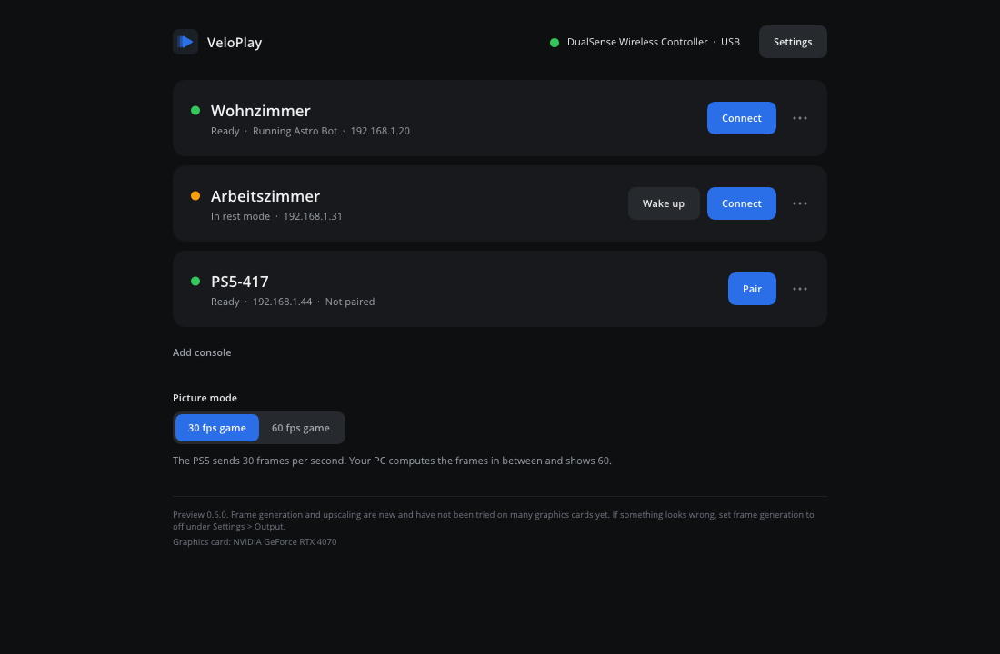
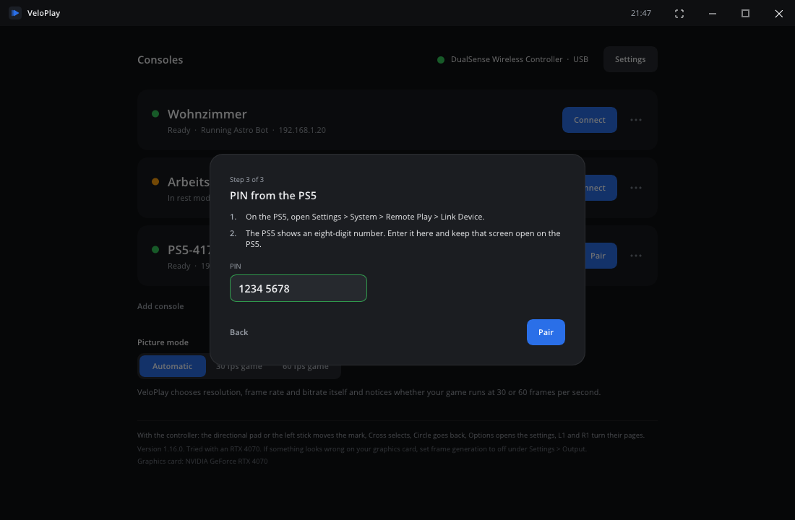
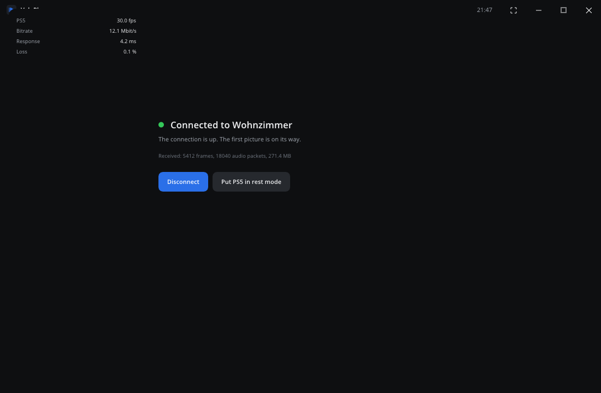

# VeloPlay

A Remote Play client for the PS5 on Windows. It is being built for one job: play console games
that run at 30 fps and see 60 on your monitor, with the picture scaled up cleanly to the
monitor's resolution.

[Deutsche Fassung](README.de.md)

> **Status: 1.0.** VeloPlay finds your PS5, pairs with it, wakes it up, connects and shows
> picture and sound on the PC. Your controller drives the console, with vibration, adaptive
> triggers and haptics, or you play with mouse and keyboard. It notices when a game runs at 30
> fps, computes the frames in between and shows 60.
>
> All of that is confirmed on a real PS5 with an RTX 4070 and a DualSense on a cable. Not tried
> yet: the microphone in a party, signing in to PlayStation for the account ID, other graphics
> cards and controllers. HDR is not built yet. Feedback is welcome.

VeloPlay is an independent open source project. It is not made or endorsed by Sony.
"PlayStation" and "PS5" are trademarks of Sony Interactive Entertainment.





Rendered by `tools/ui_preview`. On Windows the client uses Segoe UI, so letter shapes differ slightly.

## What it does today

- Finds consoles on your network and shows whether they are on, in rest mode or unreachable
- Pairs with a console in three guided steps, and can fetch your account ID by signing in to
  PlayStation
- Wakes a paired console from rest mode
- Connects to the console and shows the picture in a window or full screen, with sound
- Chooses resolution, frame rate and bitrate itself and learns per console what the connection
  carries
- Decodes the picture on the graphics card if it can, on the processor otherwise
- Notices a game that runs at 30 fps and computes the frames in between, on NVIDIA cards with
  the card's own motion search
- Scales the picture up to the window and sharpens it, on NVIDIA cards with RTX Video if you like, and smooths the colour steps a low bitrate leaves in skies
- Passes your controller's input to the console and brings vibration, adaptive triggers and
  DualSense haptics back
- Lets you play with mouse and keyboard, with presets and a layout of its own per game
- Can be steered with the controller itself, and has a page to try the controller
- Sends your microphone to the console for voice chat
- Shows frame rate, bitrate, response time and packet loss on top of the picture if you like, in
  the corner you choose, and says so when the connection stumbles
- Saves screenshots of the game with F12 and records videos with sound with F10
- Reconnects on its own after a drop and can put the PS5 into rest mode
- Measures the connection to a console and suggests stream settings that fit it
- Shows the picture of a capture card the same way (beta)
- Lets you steer with a steering wheel and pedals (beta)
- On AMD cards, can let AMD's frame rate conversion compute the pictures in between (beta)
- Shows in Discord which game you play through VeloPlay, if you like
- Updates itself with one click when a new version is published, and installs itself on your PC
  with a start menu entry if you like
- Stores the console's keys encrypted with your Windows account
- Offers a local interface for scripts ([docs/remote_control.md](docs/remote_control.md))
- Speaks German and English

## How a 30 fps game gets to 60

Many console games run at 30 fps. VeloPlay asks the PS5 for a stream with 60 frames per second.
A game that runs at 30 arrives in it with every frame twice. VeloPlay compares the frames,
notices the pattern, leaves the repeats out and computes the frame in between itself. This costs
about half a frame of extra delay, around 17 ms.

A game that runs at 60 fps on the console is shown as it arrives. Under Settings > Input you can
switch the automatic choice off and ask for 30 or 60 fps yourself.

## Requirements

- Windows 10 or 11, 64-bit
- The [Microsoft Visual C++ Redistributable](https://learn.microsoft.com/cpp/windows/latest-supported-vc-redist)
  (x64). Most PCs have it already. If Windows reports a missing `VCRUNTIME140.dll` or
  `MSVCP140.dll`, install it.
- A graphics card with Direct3D 11
- A PS5 on the same network. A cable to the router on both ends gives the best picture.
- A PSN account that is signed in on the PS5

On an NVIDIA RTX card the search for motion runs on the card's own hardware for it, and RTX
Video Super Resolution is available. VeloPlay is developed on an RTX 4070 and is meant to run on
AMD and Intel graphics too; nobody has tried it there yet.

## Setup

### 1. Prepare the PS5

On the console:

1. **Settings > System > Remote Play**: turn on *Enable Remote Play*.
2. **Settings > System > Power Saving > Features Available in Rest Mode**: turn on
   *Stay Connected to the Internet* and *Enable Turning On PS5 from Network*. Without these two,
   VeloPlay cannot wake the console.

### 2. Get VeloPlay

1. Open the [latest release](https://github.com/FynnXland/VeloPlay/releases/latest) and
   download **VeloPlay-windows-x64.zip**.
2. Unpack it into a folder of your own, for example `Documents\VeloPlay`. Do not put it under
   `C:\Program Files`: VeloPlay updates itself and needs to change its own folder.
3. Start `VeloPlay.exe`.
4. Optional: **Settings > Advanced > Install on this PC** copies VeloPlay to
   `%LOCALAPPDATA%\Programs\VeloPlay`, adds it to the start menu and to Windows' list of installed
   apps. No administrator rights are needed. You remove it like any other app under
   Settings > Apps > Installed apps; your settings stay.

From then on VeloPlay tells you when a new version is out. One click on **Update** downloads and
installs it, another one restarts the program.

Windows may warn about an unknown publisher, because the file is not signed. On the first start
Windows Firewall may ask whether VeloPlay may use the network. Allow it for private networks,
otherwise the console's answers do not reach the program.

<a id="account-id"></a>

### 3. Find your PSN account ID

The PS5 only pairs devices that belong to one of its accounts. VeloPlay proves that with your
account ID. This is a number tied to your account, not your online name. It looks like
`AbCdEfGhIjk=` (12 characters) or like a number with about 19 digits. VeloPlay accepts both.

**The easy way: sign in inside VeloPlay.** The second step of pairing has a button **Sign in
with PlayStation**. It opens Sony's sign-in page in a window of its own. You sign in as usual,
the window closes, and the account ID is in the field.

What happens: after signing in, Sony forwards to a fixed address that carries a one-time code.
VeloPlay reads that address from the window and uses it to ask Sony for your account ID.
VeloPlay does not see your password. Only the account ID is stored; what the sign-in window
leaves behind (cookies) is deleted when VeloPlay ends and at its next start.

The procedure comes from the script
[psn-account-id.py](https://github.com/streetpea/chiaki-ng/blob/main/scripts/psn-account-id.py)
of the chiaki-ng project, which credits grill2010 for it. VeloPlay performs the same steps and
identifies itself the way Sony's own Remote Play app does.

If your PC lacks the component this needs (WebView2, always part of Windows 11, on Windows 10
with Microsoft Edge), your browser opens instead. After signing in, copy the address of the
empty page you land on and paste it into the account ID field.

**By hand** still works: enter the ID from chiaki-ng or from the public lookup at
[psn.flipscreen.games](https://psn.flipscreen.games) (a third-party site that only finds
profiles visible to everyone) into the field.

The ID is not a password. VeloPlay stores it on your PC and sends it only to your PS5.

### 4. Pair

1. In VeloPlay, click **Pair** next to your console. If the console is not listed, click
   **Add console** and enter its IP address. The PS5 shows the address under
   Settings > Network > Connection Status.
2. Enter your account ID.
3. On the PS5, open **Settings > System > Remote Play > Link Device**. It shows an eight-digit
   number. Enter it in VeloPlay and keep that screen open on the PS5 until pairing is done.

Pairing is needed once per console.

### 5. Wake the console

Put the PS5 into rest mode and click **Wake up**. The status turns to *Ready* after 10 to 30
seconds.

### 6. Connect

Click **Connect**. If the console is in rest mode, VeloPlay wakes it first. After a few seconds
the PS5's picture appears in the window, and the sound plays on Windows' default output device.
If your user on the PS5 is protected by a four-digit passcode, VeloPlay asks for it while
connecting.

| Key | Effect |
| --- | --- |
| Esc | Menu that shows how picture, connection and controls are doing, with quick switches and **Resume**, **Disconnect** and **Put PS5 in rest mode** |
| F11 | Full screen on and off. VeloPlay starts in full screen and remembers if you prefer a window. In full screen, rest the pointer on the lower edge of the screen to bring the taskbar forward |
| F9 | Steps through the display in the corner: off, a small one with the essentials, all figures |
| F8 | Steps through the ways the picture is enlarged (off, Lanczos, RTX Video on NVIDIA cards), to compare them while playing |
| F10 | Starts a video recording with sound, and ends it. The video goes as MP4 into Videos\VeloPlay, without VeloPlay's display |
| F12 | Saves a screenshot of the game, without VeloPlay's display, as PNG in Pictures\VeloPlay |
| F1 | With keys and mouse: shows your key layout over the picture, and hides it again |

The display in the top left corner names how many frames per second arrive and are shown, the
bitrate, the response time, the packet loss and the decoder. “D3D11VA” there means the graphics
card decodes the picture, “CPU” means the processor does.

**Controller.** VeloPlay itself can be steered with it: directional pad or left stick to move, Cross to
select, Circle to go back, Options for the settings, L1 and R1 to turn their pages. Settings >
Controller shows live what the controller reports and lets you try vibration and, on a DualSense,
the adaptive triggers without a console.

**Microphone.** Settings > Advanced > “Send the microphone to the PS5”, or the switch in the menu
behind Esc. Off by default. While it is on and you are connected, your default microphone goes to
the console for voice chat, and the top right corner of the picture says so. Use headphones.

**DualSense.** On a USB cable you get everything: vibration, the resistance of L2 and R2 and the
fine haptics. For haptics the controller's sound device has to be set to four channels in
Windows: Settings > System > Sound > “Wireless Controller” > set the format or configuration to
“Quadraphonic”. If it is set to stereo, VeloPlay uses the vibration motors instead. Over
Bluetooth there are triggers and vibration, but no haptics.



## When the PS5 is on Wi-Fi

Remote Play runs over your home network. If the PS5 hangs on weak Wi-Fi, for example two floors
away from the router, pictures arrive late now and then and inputs feel delayed for a while.
The PC being on a cable does not help with that: the weakest stretch decides.

**Measure first.** Click the three dots next to your console and choose **Check connection**.
VeloPlay sends the console small packets and shows how fast and how evenly it answers. Bars of
equal height mean a steady link. Red marks are lost packets. The verdict comes with a suggested
bitrate that you can take over with one click.

**What helps most, in this order:**

1. **A cable for the last metres.** Put a Wi-Fi repeater or mesh node with a LAN port next to the
   PS5 and connect the two with a short cable. The repeater has better antennas than the console
   and holds the link to the router more steadily.
2. **Powerline adapters.** They carry the network over the power line, so no new cable has to
   run between floors. How well this works depends on the wiring of the house. In many houses it
   is clearly steadier than Wi-Fi through two ceilings.
3. **The right Wi-Fi band.** On the PS5, open Settings > Network > Settings > Set Up Internet
   Connection, select your network, press the Options button and choose the Wi-Fi frequency
   band. 5 GHz is faster and less crowded, 2.4 GHz gets through walls and ceilings better. Try
   both and measure each time.
4. **Less load.** A lower bitrate keeps a weak link from clogging. The 30 fps mode helps here as
   well, because it sends half as many pictures. Pause large downloads while you play.

There is no direct connection between PC and PS5 that bypasses the network. Bluetooth and USB do
not carry Remote Play.

## If something does not work

**The console is not found.** The official Remote Play app finds consoles through your PSN
account, VeloPlay searches the home network. One finding it does not mean the other can.
VeloPlay first calls into the whole network and, after a few seconds without an answer, asks
every address one by one. If the list is still empty after 15 seconds:

1. On the PS5, look up the IP address under Settings > Network > View Connection Status and enter
   it in VeloPlay under Settings > Advanced > Additional addresses.
2. If the console shows up then, the path through the network was the problem, and the entered
   address simply stays. Best give the PS5 a fixed address in your router.
3. If it still does not show up, PC and PS5 are probably on separate networks, or security
   software blocks VeloPlay. The most common case is the guest Wi-Fi: it is shut off from the
   home network on purpose. On a FRITZ!Box the PS5's address then starts with `192.168.179.`.
   Connect the PS5 to the regular Wi-Fi.

For a bug report, the output of these two commands helps, run in VeloPlay's folder:

```powershell
.\veloplay-cli.exe discover
```

```powershell
.\veloplay-cli.exe discover --host 192.168.1.20
```

Replace the address in the second command with the PS5's.

**Pairing fails.** The PIN is valid for a few minutes and only once. Open Link Device again for a
fresh PIN. If the PS5 keeps saying no, the account ID probably belongs to a different account
than the one signed in on the console.

**The console does not wake up.** Check the two power saving settings from step 1. A console
that was unplugged has to be started by hand once.

**The connection does not come up.** VeloPlay names the reason the console reports: it does not
accept connections (Remote Play switched off, or the console is off), another device is already
connected through Remote Play, or the pairing is no longer valid. Pairing again fixes the last
one. When a running connection drops, VeloPlay tries three more times. If that happens often,
measure the link with “Check connection” in the console's menu.

For bug reports there is a command line tool. It connects for ten seconds, shows every step and
writes the video to a file that VLC or ffplay can open:

```powershell
.\veloplay-cli.exe stream --out test.h265
```

**The update does not install.** VeloPlay has to be able to change its own folder. If it sits in
a protected place, move the folder somewhere under your user profile or download the new version
by hand from the release page.

**For a closer look**, the download contains `veloplay-cli.exe`. It runs the same steps in a
terminal and prints what the console answers:

```bash
veloplay-cli discover
```

```bash
veloplay-cli ping --host 192.168.1.20
```

```bash
veloplay-cli pair --host 192.168.1.20 --account-id AbCdEfGhIjk= --pin 12345678
```

The log of the current run is in `%APPDATA%\VeloPlay\veloplay.log`. The three runs before it are
kept next to it as `veloplay.1.log` (the run before), `veloplay.2.log` and `veloplay.3.log`. If
VeloPlay hung and you started it again, the log to attach to the bug report is `veloplay.1.log`.
The logs contain no keys.

## Your data

Settings and paired consoles are stored in `%APPDATA%\VeloPlay\config.json`. The keys a console
hands out during pairing are encrypted with Windows DPAPI. Only your Windows account on this PC
can read them. If you copy the file to another PC, the consoles stay in the list and have to be
paired again.

VeloPlay talks to your PS5 and, for updates, to GitHub. At startup it asks GitHub which version
is the latest. That request carries nothing about you or your console; GitHub sees your IP
address, as any website does. You can switch the check off under Settings > Advanced > Updates.
There is no telemetry.

An update is downloaded from the release page of this project over HTTPS, and VeloPlay compares
it with the SHA-256 checksum that GitHub publishes for the file before it touches anything. The
files are not signed with a certificate of their own.

## Building from source

The parts without a window (protocol, input, settings) and all tests build on Linux and macOS:

```bash
sudo apt-get install -y ninja-build libssl-dev nlohmann-json3-dev libspdlog-dev libgtest-dev \
  libavcodec-dev libavutil-dev libopus-dev
cmake --preset core
cmake --build --preset core
ctest --preset core
```

The Windows client needs Visual Studio 2022 or newer with the C++ workload and the component
“C++ Clang tools for Windows” (Visual Studio Installer, “Individual components”), CMake 3.25 and
[vcpkg](https://github.com/microsoft/vcpkg). The Clang tools compile chiaki-ng's protocol library,
which Microsoft's compiler does not accept. Check out vcpkg at the commit named as
`builtin-baseline` in `vcpkg.json`, then:

```powershell
$env:VCPKG_ROOT = "C:\path\to\vcpkg"
cmake --preset windows
cmake --build --preset windows
ctest --preset windows
```

The first build compiles the dependencies and takes a while. The client ends up in
`build\windows\app\Release`.

### Publishing a version

Raise the version in `CMakeLists.txt` and `vcpkg.json`, then start the **Release** workflow from
the Actions tab (or push a tag such as `v0.3.0`). It builds the client, runs the tests and
publishes `VeloPlay-windows-x64.zip` as a GitHub release. Installed clients pick it up at their
next start. The update check uses GitHub's public API, so it only works while the repository is
public.

To look at the screens without Windows or a console, build the `ui-preview` preset. It renders
every screen into an image file. [CLAUDE.md](CLAUDE.md) describes the layout of the code and the
rules it follows (in German).

## Roadmap

Done and in 1.0: finding, pairing and waking the console, the stream with picture and sound,
controller with triggers and haptics, mouse and keyboard, frame generation, upscaling, the menu
in the game, self-update.

Next:

1. Recover by itself when the graphics driver restarts
2. Play from outside the home network
3. HDR

## Credits

The PS5 Remote Play protocol was worked out by the authors of
[Chiaki](https://git.sr.ht/~thestr4ng3r/chiaki) and
[chiaki-ng](https://github.com/streetpea/chiaki-ng). Discovery, wake-up and pairing are written
from scratch in VeloPlay. For the session and the stream transport VeloPlay includes chiaki-ng's
library `libchiaki`. FFmpeg decodes the picture, Opus the sound. [docs/protocol_notes.md](docs/protocol_notes.md) describes the parts,
[THIRD_PARTY.md](THIRD_PARTY.md) lists all third-party components and their licenses.

## License

VeloPlay is free software under the [GNU Affero General Public License, version 3](LICENSE). You
may use, study, change and share it. If you pass on a changed version, or run one as a service
for others, you have to make its source code available under the same license.
